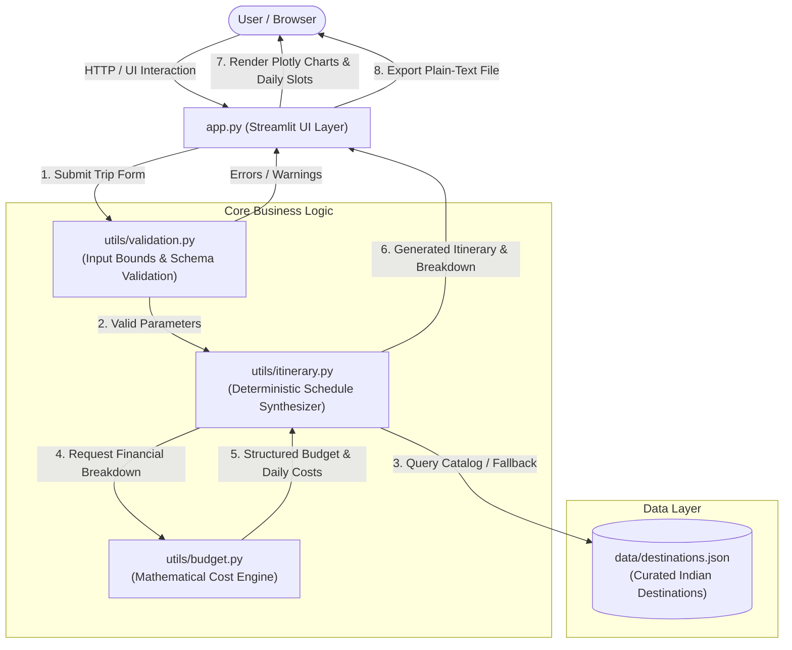

# Personalized Travel Itinerary Planner

An intelligent, deterministic travel planning engine designed for academic capstone demonstration and production deployment via Streamlit Community Cloud. Generates personalized day-by-day itineraries, interactive Plotly budget visualizations, and exportable offline trip blueprints without requiring paid external APIs or third-party accounts.

---

## 1. Problem Statement

Modern travelers face fragmented planning workflows. Commercial travel applications frequently lock features behind paid subscriptions or rely on opaque Large Language Model (LLM) APIs. These external LLM-based services introduce:
- High latency and unpredictable downtime.
- Mandatory recurring API subscription fees.
- Non-deterministic "hallucinations" of non-existent monuments, opening hours, or unrealistic travel logistics.
- Inconsistent and mathematically unverified expense estimations.

The **Personalized Travel Itinerary Planner** addresses these shortcomings through a high-performance, deterministic rule-based planning engine that balances transparent Indian Rupee (INR) cost modeling, dietary and pace accommodations, and defensive data validation.

---

## 2. Project Objectives

1. **Deterministic Itinerary Synthesis**: Generate structured day-by-day schedules (morning, afternoon, evening slots) using curated catalog intelligence or adaptive heuristics for unlisted destinations.
2. **Transparent Mathematical Budgeting**: Model accommodation (strictly night-based), shared private vehicle and double room costs, food tiers, activity admissions, and contingency reserves.
3. **Interactive & Accessible UI**: Deliver a responsive dashboard featuring Plotly data visualizations, custom CSS aesthetics, and intuitive session-state preservation.
4. **Deployability & Zero Cost**: Ensure out-of-the-box local and cloud execution without paid API keys, databases, or mandatory user registration.
5. **Comprehensive Verification**: Provide a robust Pytest suite verifying validation logic, budget consistency, and date boundaries.

---

## 3. Key Features

- **Personalized Itineraries**: Daily schedules calibrated to 6 travel styles (*Budget, Adventure, Cultural, Relaxation, Family, Luxury*) and 3 daily activity intensities (*Relaxed, Balanced, Packed*).
- **Curated Indian Destination Catalog**: Bundled with rich metadata for 10 premier travel hubs:
  - **Jaipur**, **Udaipur**, **Goa**, **Mumbai**, **Delhi**, **Varanasi**, **Manali**, **Kochi**, **Agra**, and **Bengaluru**.
- **Adaptive Fallback Engine**: Seamlessly designs coherent itineraries for any unlisted destination worldwide without crashing.
- **Smart Budget Dashboard**:
  - Key Performance Indicators (KPIs) for Total Budget, Estimated Cost, Variance (Overspend/Surplus), and Per-Traveler Cost.
  - Interactive Plotly Donut Chart for category distributions.
  - Interactive Plotly Stacked Bar Chart for daily expense trajectories.
  - Actionable cost-optimization recommendations when budgets are exceeded.
- **Dietary-Aware Dining Suggestions**: Specific culinary ideas tailored for *Vegetarian, Vegan, No Preference,* and *Other* dietary regimens.
- **Offline Plain-Text Export**: One-click download button producing clean, formatted itinerary text files (`travel_itinerary_<destination>.txt`).
- **Session State Preservation**: Keeps configured trips active during UI interactions without accidental resets.

---

## 4. Technology Stack

- **Core Runtime**: Python 3.11+
- **Presentation & Frontend**: Streamlit (Modern Web Framework)
- **Data Manipulation**: Pandas
- **Interactive Visualizations**: Plotly (Plotly Express & Plotly Graph Objects)
- **Testing Framework**: Pytest
- **Standard Library Modules**: `datetime`, `math`, `json`, `dataclasses`, `pathlib`, `logging`, `re`

---

## 5. System Architecture

The application adopts a modular layered architecture ensuring strict separation between UI rendering, business rules, financial calculations, and data validation:



---

## 6. Project Directory Structure

```text
travel-itinerary-planner/
│
├── app.py                      # Main Streamlit web application dashboard
├── requirements.txt            # Pinned dependency manifest
├── README.md                   # Comprehensive documentation and technical report
├── pytest.ini                  # Pytest configuration settings
├── .gitignore                  # Git VCS exclusion rules
│
├── data/
│   └── destinations.json       # Curated destination catalog (10 cities, attractions, costs, tips)
│
├── utils/
│   ├── __init__.py             # Module initialization
│   ├── itinerary.py            # Deterministic itinerary generator and text exporter
│   ├── budget.py               # Mathematical budget calculator and cost-saving advisory
│   └── validation.py           # Defensive input and schema validation
│
└── tests/
    ├── __init__.py             # Test package initialization
    ├── test_itinerary.py       # Itinerary generation and boundary tests
    ├── test_budget.py          # Cost modeling, night calculation, and overspend tests
    └── test_validation.py      # Input constraint and catalog schema tests
```

---

## 7. Application Workflow

1. **Discovery & Input**: The user explores destination cards in the *Explore Destinations* tab or fills out the planning form directly on the *Plan My Trip* tab.
2. **Form Parameters**:
   - Destination (Catalog match or custom text).
   - Inclusive start and end dates.
   - Number of travelers (1 to 20).
   - Total trip budget in INR.
   - Travel style, daily pace, accommodation type, local transit mode, dietary preference, and activity themes.
3. **Validation Stage**: `utils/validation.py` enforces business constraints:
   - Validates that `start_date <= end_date` and duration is within supported limits (up to 60 days).
   - Ensures traveler count is between 1 and 20.
   - Confirms budget is positive and realistic.
4. **Itinerary Synthesis**: `utils/itinerary.py` calculates the exact number of days, matches preferred activities, scores attractions, allocates morning/afternoon/evening slots based on pace, and attaches dietary meal ideas.
5. **Budget Calculation**: `utils/budget.py` computes night-based lodging, per-vehicle shared transit or per-person transit, dining expenses, admissions, and a 7% contingency reserve.
6. **Rendering**: The UI displays KPI metrics, Plotly expense charts, transparent cost tables, day-by-day expandable schedule tabs, and a one-click text export button.

---

## 8. Itinerary Generation Methodology

The itinerary engine uses a **deterministic scoring and allocation algorithm** rather than an external generative AI or LLM:
1. **Catalog Matching**: Destination names are sanitized and matched case-insensitively against `data/destinations.json`.
2. **Heuristic Scoring**:
   $$\text{Score} = \text{Base} (1.0) + \text{Preference Bonus} (4.0) + \text{Style Affinity} (1.5 - 3.5) - \text{Budget Penalty}$$
   Attractions matching user-selected activity categories or affinity styles are prioritized.
3. **Pacing Rules**:
   - **Relaxed**: Morning attraction + Afternoon leisure rest break + Evening scenic stroll.
   - **Balanced**: Morning activity + Afternoon activity + Evening activity.
   - **Packed**: High-intensity schedule with 3 full activities across morning, afternoon, and evening.
4. **Deduplication**: Scheduled attractions are popped from the available pool so no monument is scheduled twice unless the trip exceeds catalog capacity.
5. **Adaptive Fallback**: For destinations not present in the catalog, generic orientation and cultural templates are used, tagged transparently as `Generic Recommendation`.

---

## 9. Budget Calculation Methodology

All calculations are performed strictly in Indian Rupees (INR) with explicit cost models:

| Category | Cost Model | Formula |
| :--- | :--- | :--- |
| **Accommodation** | Night-based (`max(0, days - 1)`). Shared double occupancy for hotels; per bed for hostels. | $\lceil\text{Travelers} / 2\rceil \times \text{Rate} \times \text{Nights}$ |
| **Food & Dining** | Per traveler per day scaled by travel style. | $\text{Travelers} \times \text{Daily Rate} \times \text{Days}$ |
| **Local Transportation** | Shared standard vehicle (up to 4 travelers/car) for taxis/rentals; per traveler for transit. | $\lceil\text{Travelers} / 4\rceil \times \text{Vehicle Rate} \times \text{Days}$ |
| **Activities** | Per traveler based on admission fees of scheduled activities. | $\sum (\text{Activity Ticket}) \times \text{Travelers}$ |
| **Contingency** | 7% reserve for unexpected transfers, municipal fees, and tips. | $0.07 \times (\text{Subtotal})$ |

**Same-Day Excursions**: For a single-day trip (`start_date == end_date`), accommodation is automatically set to ₹0.00.

---

## 10. Data Model Description

The destination catalog in `data/destinations.json` adheres to a strict schema:

```json
{
  "id": "jaipur",
  "name": "Jaipur",
  "state": "Rajasthan",
  "tagline": "The Historic Pink City of Forts and Palaces",
  "description": "Known for its royal palaces, imposing hill forts, and vibrant bazaars...",
  "styles": ["Cultural", "Historical Landmarks", "Family", "Budget", "Luxury"],
  "climate_summary": "Warm semi-arid climate; best visited between October and March.",
  "suggested_duration_days": 3,
  "attractions": [
    {
      "id": "amber-fort",
      "name": "Amber Fort and Palace",
      "category": "Historical Landmarks",
      "description": "Majestic hilltop fortress overlooking Maota Lake...",
      "duration_hours": 3.0,
      "indicative_cost_inr": 200,
      "best_time_of_day": "Morning",
      "practical_tips": "Climb early in the morning to beat the heat."
    }
  ],
  "meals": {
    "breakfast": [{"name": "Pyaaz Kachori & Jalebi", "diet": "Vegetarian", "style": "Street Food"}],
    "lunch": [{"name": "Rajasthani Dal Baati Churma Thali", "diet": "Vegetarian", "style": "Heritage Thali"}],
    "dinner": [{"name": "Grand Royal Thali", "diet": "Vegetarian", "style": "Traditional Thali"}]
  },
  "transport_tips": "Auto-rickshaws and app-based cabs (Uber/Ola) are widely available.",
  "notes": "Modest clothing recommended when visiting temples."
}
```

---

## 11. Installation Instructions

### Prerequisites
- Python 3.11 or a compatible release (3.10 to 3.12).
- Operating System: Windows, macOS, or Linux.

### Setup Steps
1. Navigate to the project directory:
   ```bash
   cd travel-itinerary-planner
   ```

2. (Optional but recommended) Create and activate a virtual environment:
   ```bash
   # Windows
   python -m venv venv
   .\venv\Scripts\activate

   # macOS / Linux
   python3 -m venv venv
   source venv/bin/activate
   ```

3. Install required dependencies:
   ```bash
   python -m pip install -r requirements.txt
   ```

---

## 12. Local Execution Instructions

To launch the interactive dashboard locally:

```bash
streamlit run app.py
```

Streamlit will automatically launch your default browser to `http://localhost:8501`.

---

## 13. Testing Instructions

The project includes an automated test suite verifying validation logic, budget calculations, date boundaries, and fallback workflows:

```bash
python -m pytest -q
```

To run tests with full verbose output:

```bash
python -m pytest tests -v
```

All 25 unit tests verify:
- Single-day, multi-day, and month-spanning date ranges.
- Zero-night lodging rules on same-day trips.
- Cost scaling with traveler counts.
- Strict budget sum equality and overspend warnings.
- Defensive rejection of invalid budgets, dates, and traveler numbers.

---

## 14. Streamlit Community Cloud Deployment Instructions

Deploying the application live on the cloud takes under two minutes:

1. **Create a Public GitHub Repository**:
   - Go to [GitHub](https://github.com/) and create a new public repository (e.g., `travel-itinerary-planner`).
2. **Upload Project Files**:
   - Push or upload all repository files (`app.py`, `requirements.txt`, `README.md`, `.gitignore`, `pytest.ini`, `data/`, `utils/`, and `tests/`).
3. **Open Streamlit Community Cloud**:
   - Visit [share.streamlit.io](https://share.streamlit.io/) and log in with your GitHub account.
4. **Connect Repository**:
   - Click **New app**, select your repository and branch (`main`).
5. **Configure Entry Point**:
   - Specify `app.py` in the **Main file path** field.
6. **Deploy**:
   - Click **Deploy!**. Streamlit will install the requirements from `requirements.txt` and launch the container.
7. **Verification**:
   - Open the live URL in an incognito window.
   - Verify destination discovery, form submission, Plotly charts, and the plain-text download button.

---

## 15. Known Limitations

- **Bundled Catalog Scope**: The detailed local attraction database currently focuses on 10 prominent Indian tourism hubs. Other global destinations use the adaptive generic planning workflow.
- **Static Benchmarks**: Ticket prices and operating hours represent illustrative benchmarks and do not reflect real-time holiday closures or surge tariffs.
- **Deterministic vs Dynamic Weather**: Does not pull live Doppler radar or monsoon advisories via external APIs.

---

## 16. Future Enhancements

- **OpenStreetMap / Folium Integration**: Add interactive map markers displaying route poly-lines between morning and afternoon attractions.
- **Multi-City Itineraries**: Support multi-leg trips connecting consecutive destinations with intercity rail/flight schedules.
- **PDF Export**: Provide styled PDF export alongside the plain-text download option.
- **Live Currency Converter**: Allow international travelers to view budget breakdowns in USD, EUR, or GBP alongside INR.

---

## 17. Data and Pricing Disclaimer

> **IMPORTANT NOTICE:**  
> All admission costs, opening hours, durations, and meal options in this application are illustrative planning benchmarks intended for academic demonstration. Prices and timings are subject to change. Travelers must independently verify timings, ticket requirements, and entry permits with official authorities prior to travel.
